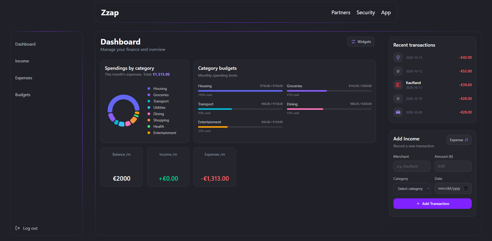

# ZZAP — Personal Finance Dashboard

ZZAP is a personal finance dashboard built with React for tracking income and expenses, monitoring category budgets, and visualizing financial activity.

The project focuses on reusable UI components, data-driven financial widgets, API integration, and maintainable frontend architecture.

## Preview



## Features

- **Financial overview** — View account balance, income, expenses, and recent transactions.
- **Transaction management** — Record income and expenses and review transaction history.
- **Budget tracking** — Set category spending limits, monitor usage, and identify overspending.
- **Spending analytics** — Visualize expenses by category and compare income and spending across three months.
- **Customizable dashboard** — Select dashboard widgets while respecting section-specific layout limits.
- **Authentication** — Register, log in, maintain a session, and log out.
- **Form handling** — Reusable form logic with validation and submission state management.

## Tech Stack

- **Frontend:** React, JavaScript, TypeScript
- **Build tool:** Vite
- **Styling:** Tailwind CSS
- **Charts:** Recharts
- **Routing:** React Router
- **Testing:** Vitest, React Testing Library, and jest-dom
- **API communication:** Fetch API
- **Backend:** SoftUni Practice Server

## Technical Highlights

### Reusable Hooks

Custom hooks encapsulate recurring application logic, including API requests, form state and validation, local storage persistence, and authentication.

### Configurable Widget System

A central widget registry defines widget metadata, components, sizes, and section assignments. The dashboard uses this registry to render selected widgets and enforce layout capacity limits.

### Financial Calculations

Dedicated utility functions calculate budget usage and remaining amounts, aggregate transaction totals, and prepare data for visualizations.

### Automated Testing

The test suite uses Vitest and React Testing Library to cover API request behavior, authentication flows, form logic, financial calculations, and selected UI components. AI-assisted test development was used to identify edge cases, expand test coverage, and validate expected behavior, with generated tests reviewed and refined to fit the application's implementation.

## Getting Started

### Prerequisites

- Node.js and npm
- The project's backend API, provided by the [SoftUni Practice Server](https://github.com/SoftUni/Practice-Server), running locally at `http://localhost:3030`

### Installation

Clone the repository:

```bash
git clone https://github.com/Rusevrn/personal-finance-dashboard.git
cd personal-finance-dashboard
```

### 1. Start the Backend

Open a terminal in the repository root and run:

```bash
cd server
node server.js
```

Keep this terminal running. The API should be available at `http://localhost:3030`.

### 2. Start the Frontend

Open a **second terminal** in the repository root and run:

```bash
cd client
npm install
npm run dev
```

Open the local URL printed by Vite in your terminal.

**Note:** Authentication and data-dependent features require the backend to be running. The frontend currently expects the API at `http://localhost:3030`.

## Available Scripts

| Command | Description |
|---|---|
| `npm run dev` | Start the Vite development server |
| `npm run build` | Build the frontend for production |
| `npm run preview` | Preview the production build locally |
| `npm run test` | Run tests with Vitest |
| `npm run lint` | Run ESLint |

Run these commands from the `client` directory.

## Project Status

ZZAP is an ongoing personal portfolio project focused on frontend development, application architecture, TypeScript, and automated testing.

## Acknowledgements

The backend is powered by the [SoftUni Practice Server](https://github.com/SoftUni/Practice-Server), used for API development and testing.

## Author

**Rosen Rusev**

- GitHub: [@Rusevrn](https://github.com/Rusevrn)